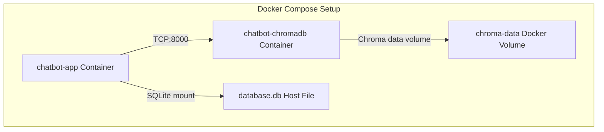

# Dockerization Implementation Plan

> **For agentic workers:** REQUIRED SUB-SKILL: Use superpowers:subagent-driven-development to implement this plan task-by-task. Steps use checkbox (`- [ ]`) syntax for tracking.

**Goal:** Containerize the Node.js/OpenClaw server and ChromaDB database using Docker Compose to deploy local instances on Debian Minimal.

**Architecture:** We will create a `Dockerfile` for the Node.js application, write a `docker-compose.yml` that pulls the official ChromaDB image and builds our local `Dockerfile`, and modify [chatbot.js](file:///home/chatbot/Projects/ChatbotAI/chatbot.js) and [init_db.js](file:///home/chatbot/Projects/ChatbotAI/init_db.js) to connect dynamically via container service name.

**Architecture Diagram:**



**Tech Stack:** Docker, Docker Compose, Node.js, Express, ChromaDB, SQLite3.

---

### Task 1: Code adjustments for dynamic ChromaDB connection

**Files:**
* Modify: [chatbot.js](file:///home/chatbot/Projects/ChatbotAI/chatbot.js#L6)
* Modify: [init_db.js](file:///home/chatbot/Projects/ChatbotAI/init_db.js#L7)

- [ ] **Step 1: Modify chatbot.js to use environment variables for ChromaDB connection**
  
  Replace line 6 in `chatbot.js`:
  ```diff
  -const client = new ChromaClient({ host: "localhost", port: 8000 });
  +const client = new ChromaClient({
  +  host: process.env.CHROMA_HOST || "localhost",
  +  port: parseInt(process.env.CHROMA_PORT) || 8000
  +});
  ```

- [ ] **Step 2: Modify init_db.js to use environment variables for ChromaDB connection**

  Replace line 7 in `init_db.js`:
  ```diff
  -const client = new ChromaClient({ host: "localhost", port: 8000 });
  +const client = new ChromaClient({
  +  host: process.env.CHROMA_HOST || "localhost",
  +  port: parseInt(process.env.CHROMA_PORT) || 8000
  +});
  ```

- [ ] **Step 3: Verify syntax of modified files**

  Run: `node -e "require('./chatbot'); console.log('chatbot.js syntax OK');"`
  Expected output: `chatbot.js syntax OK`

  Run: `node -c init_db.js && console.log('init_db.js syntax OK');`
  Expected output: `init_db.js syntax OK`

---

### Task 2: Create Docker configuration files

**Files:**
* Create: `/Dockerfile`
* Create: `/.dockerignore`
* Create: `/docker-compose.yml`

- [ ] **Step 1: Create Dockerfile at the root of the project**

  Create file [Dockerfile](file:///home/chatbot/Projects/ChatbotAI/Dockerfile) with the following content:
  ```dockerfile
  FROM node:20-slim

  WORKDIR /app

  COPY package*.json ./

  RUN npm ci --only=production

  COPY . .

  EXPOSE 3000

  CMD ["node", "index.js"]
  ```

- [ ] **Step 2: Create .dockerignore file**

  Create file [.dockerignore](file:///home/chatbot/Projects/ChatbotAI/.dockerignore) with the following content:
  ```ignore
  node_modules
  npm-debug.log
  database.db
  chromadb_data
  .env
  .git
  .agents
  ```

- [ ] **Step 3: Create docker-compose.yml file**

  Create file [docker-compose.yml](file:///home/chatbot/Projects/ChatbotAI/docker-compose.yml) with the following content:
  ```yaml
  version: '3.8'

  services:
    chromadb:
      image: chromadb/chroma:latest
      container_name: chatbot-chromadb
      ports:
        - "8000:8000"
      environment:
        - ANONYMIZED_TELEMETRY=False
      volumes:
        - chroma-data:/chroma/chroma
      restart: always

    chatbot:
      build: .
      container_name: chatbot-app
      ports:
        - "3000:3000"
      environment:
        - CHROMA_HOST=chromadb
        - CHROMA_PORT=8000
      env_file:
        - .env
      volumes:
        - ./database.db:/app/database.db
      depends_on:
        - chromadb
      restart: always

  volumes:
    chroma-data:
  ```

- [ ] **Step 4: Verify files are created successfully**

  Run: `ls -la Dockerfile .dockerignore docker-compose.yml`
  Expected output: List of files with their details.
