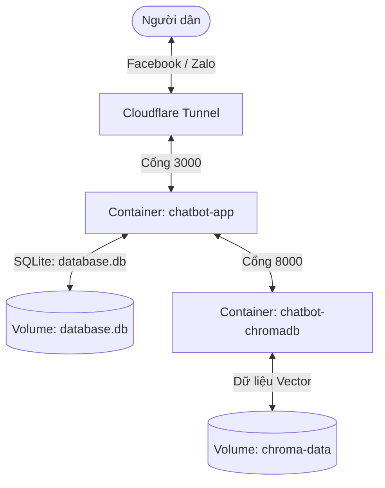

# Thiết kế Container hóa (Dockerization) - Chatbot AI Công an Phường

* **Ngày lập:** 2026-06-17
* **Trạng thái:** Đã phê duyệt (Hướng A - Dự án Node.js hiện tại)

---

## 1. Mục tiêu thiết kế
Thiết lập môi trường đóng gói Docker và Docker Compose cho toàn bộ hệ thống Chatbot AI (Node.js/OpenClaw + ChromaDB + SQLite) nhằm đảm bảo:
* **An toàn thông tin:** Khép kín ứng dụng trong môi trường container cô lập trên máy chủ Debian Minimal.
* **Tính nhất quán:** Dễ dàng sao chép và khởi chạy hệ thống trên bất kỳ máy chủ nào mà không lo xung đột thư viện/môi trường.
* **Bảo toàn dữ liệu:** Lưu trữ trạng thái phiên chat (SQLite) và dữ liệu tri thức luật (ChromaDB) vĩnh viễn trên host thông qua Docker Volumes.

---

## 2. Kiến trúc Hệ thống (Docker Network)



* Hai container `chatbot-app` và `chatbot-chromadb` kết nối qua một Docker Network nội bộ.
* `chatbot-app` kết nối tới ChromaDB bằng DNS name `chromadb:8000` (thay vì `localhost:8000`).

---

## 3. Đặc tả các tệp tin cấu hình

### 3.1. File `Dockerfile` (Cho ứng dụng Node.js)
Đặt tại gốc dự án `/Dockerfile`:
```dockerfile
FROM node:20-slim

WORKDIR /app

COPY package*.json ./

RUN npm ci --only=production

COPY . .

EXPOSE 3000

CMD ["node", "index.js"]
```

### 3.2. File `.dockerignore`
Đảm bảo không copy các file rác và node_modules vào container. Đặt tại gốc dự án `/.dockerignore`:
```ignore
node_modules
npm-debug.log
database.db
chromadb_data
.env
.git
.agents
```

### 3.3. File `docker-compose.yml`
Đặt tại gốc dự án `/docker-compose.yml`:
```yaml
version: '3.8'

services:
  chromadb:
    image: chromadb/chroma:latest
    container_name: chatbot-chromadb
    ports:
      - "8000:8000"
    environment:
      - ANONYMIZED_TELEMETRY=False
    volumes:
      - chroma-data:/chroma/chroma
    restart: always

  chatbot:
    build: .
    container_name: chatbot-app
    ports:
      - "3000:3000"
    environment:
      - CHROMA_HOST=chromadb
      - CHROMA_PORT=8000
    env_file:
      - .env
    volumes:
      - ./database.db:/app/database.db
    depends_on:
      - chromadb
    restart: always

volumes:
  chroma-data:
```

---

## 4. Các thay đổi về mã nguồn (Code Adjustments)
Cần điều chỉnh kết nối tĩnh từ `localhost` sang động thông qua biến môi trường trong các tệp:
1. **[chatbot.js](file:///home/chatbot/Projects/ChatbotAI/chatbot.js):** Sửa dòng khởi tạo `ChromaClient` để đọc `CHROMA_HOST` và `CHROMA_PORT`.
2. **[init_db.js](file:///home/chatbot/Projects/ChatbotAI/init_db.js):** Sửa dòng khởi tạo `ChromaClient` tương tự để đảm bảo script seed dữ liệu hoạt động chính xác trong môi trường container.

---

## 5. Tiêu chí kiểm thử & Xác minh (Verification Criteria)
1. **Xây dựng Image thành công:** `docker compose build` chạy không gặp lỗi.
2. **Khởi chạy thành công:** `docker compose up -d` kích hoạt cả hai container ổn định.
3. **Kết nối nội bộ:** Kiểm tra log container `chatbot-app` xác nhận kết nối thành công tới `chromadb` thông qua port 8000.
4. **Kiểm tra Health:** Gọi `curl -s http://localhost:3000/health` trả về kết quả JSON thành công.
